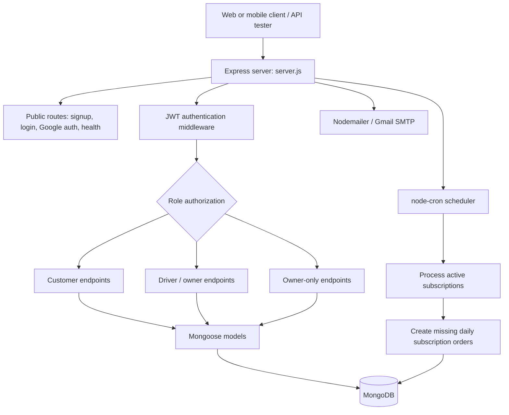
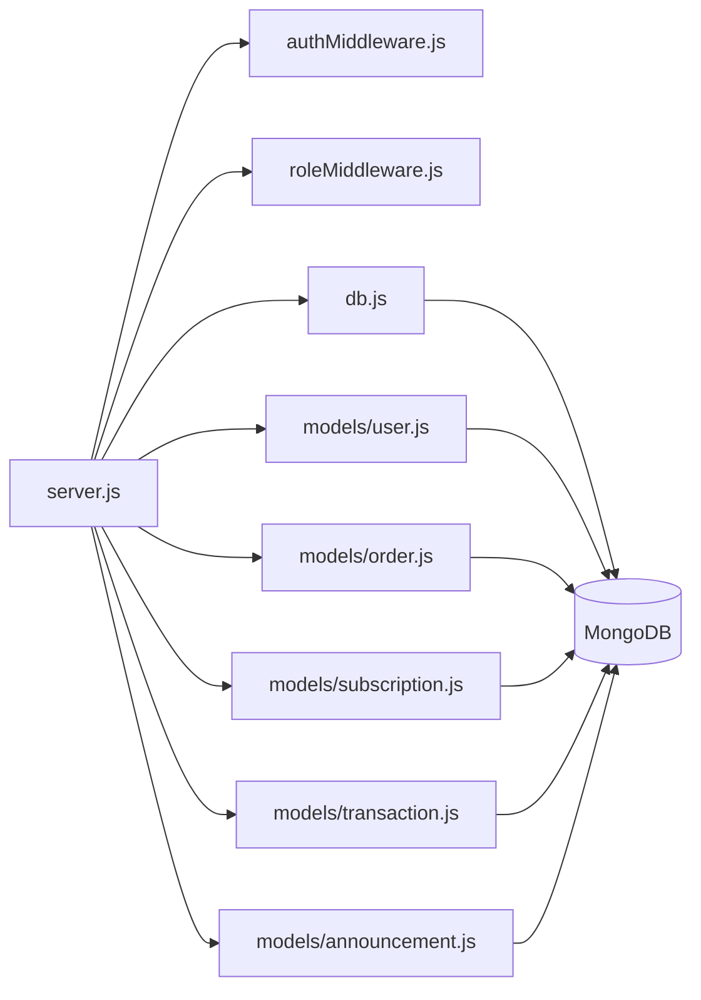

# AquaServe — Backend Architecture

This document maps the backend structure currently present in this repository. It describes the Node.js API, MongoDB models, authentication middleware, and scheduled subscription processing.

## 1. Request and data flow

## 2. Main backend modules

## 3. Implemented API areas

| Area | Current routes |
|---|---|
| Health | `GET /` |
| Authentication | `POST /api/signup`, `POST /api/login`, `POST /api/auth/google` |
| Password recovery | `POST /api/forgot-password`, `POST /api/reset-password` |
| Profile | `GET /api/profile`, `PUT /api/profile` |
| Orders and deliveries | `POST /api/orders`, `GET /api/orders`, `PUT /api/orders/update-status`, `GET /api/orders/by-date`, `GET /api/deliveries/by-date` |
| Owner summaries | `GET /api/users`, `GET /api/owner/subscriptions`, `GET /api/summary/monthly` |
| Wallet | `GET /api/wallet/balance`, `POST /api/wallet/add`, `GET /api/wallet/history` |
| Announcements | `POST /api/announcements`, `GET /api/announcements`, `GET /api/announcements/new-count`, `POST /api/announcements/read` |
| Subscriptions | `POST /api/subscription/create`, `GET /api/subscription/status`, `GET /api/subscription/preview`, `GET /api/subscription/details` |

The repository also currently exposes `GET /api/test/run-subscriptions`, a manual task trigger that should be restricted or disabled before public deployment.

## 4. Scheduled subscription workflow

The server registers a daily `node-cron` task for **12:01 AM Asia/Kolkata**. The task finds active subscriptions for the current date and creates a subscription order when one does not already exist for that user and date.

## 5. Important security boundary

- Public routes handle account creation and login; protected routes rely on JWT middleware.
- Driver/owner access is separated by role middleware.
- Passwords for customer accounts are hashed using bcryptjs.
- The source currently includes hard-coded sample driver credentials and a direct owner credential comparison. Replace these with secure account management before production.
- Wallet crediting currently changes the stored balance directly. Integrate and verify a payment provider before handling real money.
- Store secrets only in environment variables and never commit a real `.env` file.
